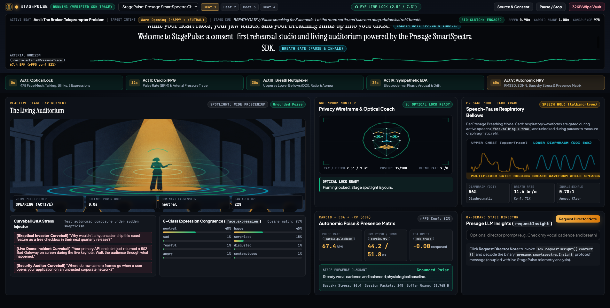
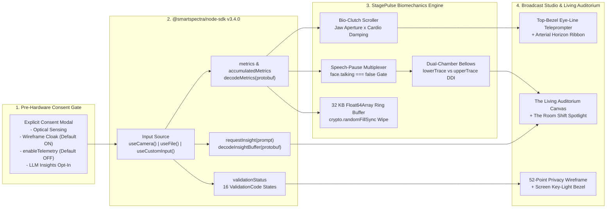

# StagePulse: Consent-First Bio-Adaptive Teleprompter, Vocal Presence Studio & Living Auditorium

**Built with `@smartspectra/node-sdk` v3.4.0 for the Presage SmartSpectra SDK Challenge**

Traditional teleprompters are physiologically blind. They scroll at a fixed mechanical speed while a speaker's heart rate climbs, their jaw tightens, and their breathing shifts up into their chest.

**StagePulse** turns the webcam into a consent-first broadcast greenroom, bio-adaptive teleprompter, and reactive auditorium. Using Presage Technologies' `@smartspectra/node-sdk` v3.4.0, StagePulse couples your live vocal articulation, pulse waveform, diaphragmatic breathing recovery, facial expression congruence, electrodermal activity (EDA), and heart rate variability (HRV) directly to the script scroller and a 60 FPS theatrical stage.



## Why StagePulse Stands Out

1. **Bio-Clutch Kinetic Teleprompter (`face.talking` + `face.landmarks` + `cardio.pulseRate`)**
   - Pinned at the top bezel (`< 3°` below the physical webcam lens) so presenters maintain direct eye contact with the camera while reading.
   - Advances script lines only while `face.talking.at(-1)?.detected === true`, modulated by live normalized jaw aperture (`landmarks[13]` vs `landmarks[14]`).
   - Applies **Cardio Tempo Damping**: if `cardio.pulseRate` rises more than 12% above your personal baseline, the teleprompter gently applies viscous speed damping (down to `0.68x`) so you never spiral into nervous speed-reading.
2. **Model-Card-Aware Speech-Pause Respiratory Multiplexer (`face.talking === false` Gate)**
   - Presage's Breathing Model Card documents a key physical constraint: optical respiratory waveforms (`upperTrace`, `lowerTrace`) and `breathing.rate` are confounded by torso motion during active speech.
   - StagePulse solves this by turning `face.talking` into a real-time **Speech-Pause Multiplexer**. While you speak (`talking === true`), StagePulse holds the respiratory waveform window (`speechHold: true`) and drives Bio-Clutch scrolling. The instant you hit a `[BREATH GATE]` rhetorical pause (`talking === false`), StagePulse opens the respiratory gate to measure thoracic (`upperTrace`) versus abdominal (`lowerTrace`) root-mean-square amplitude, computing your **Diaphragmatic Dominance Index (DDI)**, `inhaleExhaleRatio`, and `apnea` state.
3. **The Living Auditorium & "The Room Shift" (`face.expression` + Silence Power Hold)**
   - A 60 FPS HTML5 Canvas theater that responds to vocal poise.
   - Evaluates cosine congruence between all 8 `face.expression` classes (`ANGRY`, `CONTEMPT`, `DISGUST`, `FEAR`, `HAPPY`, `NEUTRAL`, `SAD`, `SURPRISE`) and the active script beat's delivery tone.
   - **The Room Shift**: holding a deliberate 1.8-second silence (`face.talking === false`) narrows the wide proscenium lights into a crisp golden spotlight cone while front-row silhouettes lean in, training presenters to treat silence as authority.
   - **Curveball Q&A Stress Injector**: fire sudden skeptic interruptions mid-pitch to measure physiological recovery latency.
4. **16-State `ValidationCode` Optical Coach & Dynamic Screen Key-Light Bezel**
   - Translates all 16 `ValidationCode` enums (`kOk = 0` through `kFaceNotForward = 17`) with 3-frame hysteresis into greenroom stage directions.
   - When `ValidationCode.kTooDark (5)` fires, StagePulse illuminates a warm tungsten **Screen Key-Light Border** around the display to physically light the speaker's face.
5. **Pre-Hardware Consent Gate, Wireframe Cloak & 32 KB CSPRNG Memory Wipe**
   - Zero camera discovery or SDK initialization happens before explicit consent confirmation.
   - **Privacy Wireframe Cloak** (default `ON`) suppresses raw `videoOutput` RGB frames and renders only a normalized 52-point geometric wireframe mesh.
   - Passes `enableTelemetry: false` by default to `new SmartSpectraSDK()` so aggregate session telemetry is opted out unless explicitly enabled.
   - Stores session scalars in a fixed 4,096-slot `Float64Array` (`32,768` bytes) in volatile RAM. Clicking **32KB Wipe Vault -> Execute CSPRNG Wipe** overwrites the buffer with cryptographic random bytes via `crypto.randomFillSync()`, computes a SHA-256 verification receipt, and zeroes all windows.

## System Architecture



## Presage SmartSpectra Signals Integrated

| Signal Group | Protobuf Field (`.at(-1)`) | Warm-Up / Gate | How StagePulse Uses It |
| :--- | :--- | :--- | :--- |
| **Validation** | `ValidationCode` (`0..7, 10..17`) | Immediate (`0s`) | Greenroom optical coach + Dynamic Screen Key-Light Bezel (`kTooDark`, `kTooBright`). |
| **Face** | `face.talking` | Immediate (`0s`) | **Bio-Clutch Teleprompter Gate** & **Speech-Pause Respiratory Multiplexer**. |
| **Face** | `face.landmarks` (478 pts) | Immediate (`0s`) | Jaw aperture (`#13/#14`), eye-contact cone (`#1/#33/#263`), posture (`#1/#152`), and 52-point Privacy Wireframe Cloak. |
| **Face** | `face.blinking` | Immediate (`0s`) | Rolling blink rate (`/min`) and composure indicator. |
| **Face** | `face.expression` (8 classes) | Immediate (`0s`) | Cosine congruence against script beat tone (`warm_opening`, `high_energy`, `serious_problem`, `calm_closing`). |
| **Cardio** | `cardio.pulseRate` | `12s` (`conf >= 40`) | Personal baseline comparison and **Cardio Tempo Damping** on teleprompter scroll speed. |
| **Cardio** | `cardio.arterialPressureTrace` | `12s` (`20 Hz`) | **Arterial Horizon Ribbon** rendered directly beneath the active teleprompter line. |
| **Cardio** | `cardio.hrv` (`rmssd`, `sdnn`, `baevsky`) | `60s` (`conf >= 50`) | Autonomic poise readout and 4-quadrant **Stage Presence Matrix**. |
| **Breathing** | `breathing.upperTrace` & `lowerTrace` | `30s` (`talking=false`) | Dual-chamber bellows comparing abdominal vs chest variance (**Diaphragmatic Dominance Index**). |
| **Breathing** | `breathing.rate`, `amplitude`, `inhaleExhaleRatio`, `apnea` | `30s` (`conf >= 45`) | Sampled during `[BREATH GATE]` pauses; triggers Apnea Rescue prompt if breath is held. |
| **EDA** | `eda.trace` | `35s` | Sympathetic micro-arousal drift tracking during Curveball Q&A interruptions. |
| **LLM Insights** | `sdk.requestInsight(prompt)` / `'insight'` | Opt-in on demand | Decodes `presage.smartspectra.Insight` protobuf messages into Stage Director coaching notes. |

## Quick Start & Setup

### Prerequisites

- **Node.js** `>= 20.0.0` (tested on Node v22.18.0, macOS Apple Silicon `darwin-arm64` / Linux `x64`)
- **Presage SmartSpectra API Key** from [physiology.presagetech.com](https://physiology.presagetech.com) (optional if using **Verified Presage SDK Trace Replay** mode, which runs with zero API credits)

### 1. Install Dependencies

```bash
npm install
```

### 2. Configure Environment

```bash
cp .env.example .env
# Edit .env and set SMARTSPECTRA_API_KEY=your_presage_api_key
```

### 3. Verify `@smartspectra/node-sdk` v3.4.0 & Run Tests

Run the automated unit and integration test suite:

```bash
npm test
```

Run the live headless SmartSpectra SDK verifier against the bundled speaker rehearsal fixture (`assets/fixtures/speaker-rehearsal-65s.mp4`):

```bash
npm run verify:sdk
```

### 4. Launch StagePulse Studio

```bash
npm start
```

Open `http://localhost:4321` in your browser:
1. Review the **Pre-Hardware Consent Gate** toggles (`Local Sensing`, `Privacy Wireframe Cloak`, `SDK Aggregate Telemetry`, and `Presage LLM Stage Director Notes`).
2. Choose your input pipeline:
   - **Live Presage SDK Engine (`useFile`)**: streams `assets/fixtures/speaker-rehearsal-65s.mp4` through `@smartspectra/node-sdk` C++ native graph in real time.
   - **Verified Presage SDK Trace Replay**: replays real packets captured from `@smartspectra/node-sdk` v3.4.0 with zero API credit usage.
   - **Live Hardware Camera (`useCamera`)**: connects directly to your webcam discovered via `SmartSpectraSDK.availableCameras()`.
3. Click **Confirm Consent & Enter StagePulse Studio**.

## Consent, Privacy & Non-Medical Framing

- **Explicit Pre-Hardware Consent**: `POST /api/session/start` rejects any request where `consentConfirmed !== true` (`CONSENT_REQUIRED`).
- **Default Telemetry Opt-Out**: `enableTelemetry` defaults to `false` when instantiating `SmartSpectraSDK`.
- **Zero Disk Persistence & CSPRNG Wipe**: Raw video frames are never written to disk. Volatile session samples reside in a 32 KB `Float64Array` that can be overwritten with `crypto.randomFillSync` and zeroed at any time via `POST /api/privacy/wipe`.
- **Ergonomic Rehearsal Notice (Non-Medical)**: StagePulse is a stagecraft, vocal pacing, and presentation rehearsal tool. It does not diagnose, treat, or monitor any medical condition.

## License

MIT License. Copyright (c) 2026 Prince Jain.
